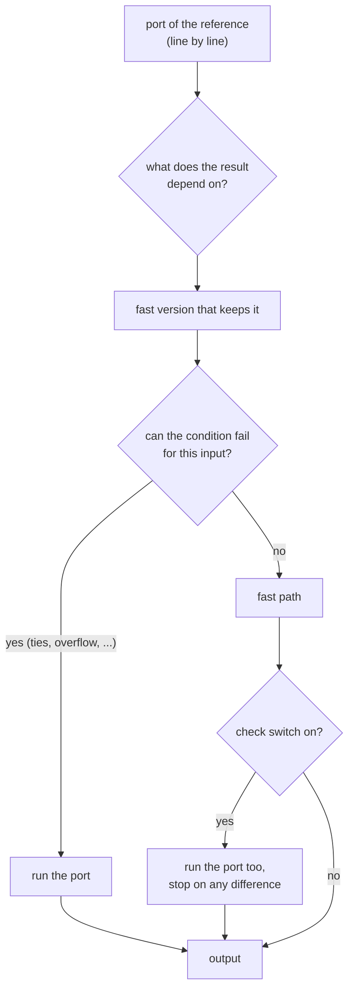
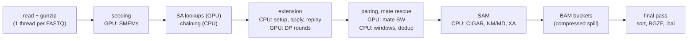
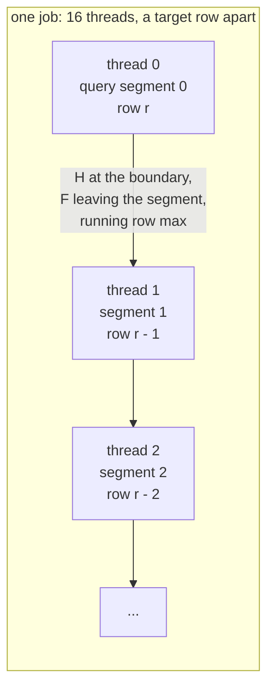
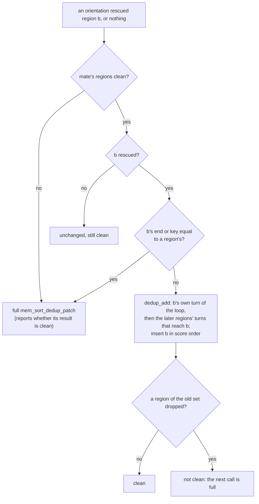
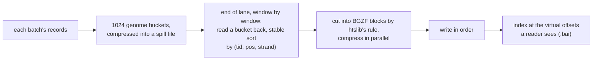

# Optimizations

Every optimization here keeps the output identical to the reference tool: bwa-mem2's records, Picard's and GATK's
BAMs, tables and VCFs. This page explains what was done and why each change is exact, so that the next speed-up
can build on it. Measurements, profiles and dead ends are in [notes/](notes/), the plan in [PLAN.md](../PLAN.md).

Numbers are from one 16-core (32-thread) workstation with an RTX 5070 Ti unless they name an L40S (a 2 × EPYC 9654
server). The **`mid` set** is a 30x subset of NA12878 (~1/5 of a lane) used for quick A/B runs; a **lane** is one
of the genome's 12 FASTQ lane pairs (~64 M records).

* [The method: exact first, then fast](#the-method-exact-first-then-fast)
* [align-rs](#align-rs)
  * [The pipeline, and what paces it](#the-pipeline-and-what-paces-it)
  * [GPU kernels](#gpu-kernels)
  * [CPU: exact shortcuts in bwa's algorithms](#cpu-exact-shortcuts-in-bwas-algorithms)
  * [Memory and allocation](#memory-and-allocation)
  * [BAM output](#bam-output)
  * [Measured and dropped](#measured-and-dropped)
  * [Open candidates](#open-candidates)
* [variant-rs](#variant-rs)
* [Proposing an optimization](#proposing-an-optimization)

## The method: exact first, then fast

The ports are written line by line against the reference first. A faster version replaces a piece only after it
is shown to give the same result, in one of these ways:

1. **Find what the result really depends on.** Usually an order (which element a loop stops at, how a sort
   breaks ties) or a rounding. Most of the reference's work turns out not to affect it.
2. **Compute the same thing faster, keeping that.** Skip work that provably changes nothing, index instead of
   scan, sum integers in any order.
3. **Check it.** Keep the reference's version beside the fast one behind a switch (`ALIGN_RS_*_CHECK=1`) that runs
   both and stops on the first difference, and compare whole outputs on data that exercises the path.



The recurring patterns:

| Pattern | Example | Where |
|---|---|---|
| Fast path, port as fallback for ties | region sorts | [Sorts](#sorts-a-fast-path-with-a-fallback-for-ties) |
| Index instead of scan, same answer | replay lookup, `pos2rid` table | [Replay](#the-replays-skip-test-a-lookup-instead-of-a-scan), [pos2rid](#pos2rid-by-a-table-of-blocks) |
| Incremental, exact by an invariant | mate rescue dedup | [Dedup](#mate-rescue-an-incremental-dedup) |
| Exact by an order (monotone test) | chain filter by group | [Chain filter](#chain-filter-by-group-of-read-interval) |
| A proof that a cheaper computation gives the same | ungapped extension, CIGAR band | [Shortcuts](#exact-shortcuts-from-bwa-mem3) |
| Same arithmetic, reorganized | SIMD CIGAR fill, GPU kernels | [SIMD](#cigar-dp-8-cells-at-a-time), [GPU](#gpu-kernels) |
| Integer sums in any order | BaseRecalibrator tables | [variant-rs](#integers-where-gatk-sums-floating-point) |
| Bit-exact floating point | GPU PairHMM | [PairHMM](#a-bit-exact-gpu-pairhmm) |
| One sequential stream shared in order | GATK's random numbers | [RNG baton](#parallel-contigs-sequential-random-numbers) |

Measure first, every time:

* `ALIGN_RS_PROFILE=1` and `VARIANT_RS_TRACE_STAGES=1` give per-stage times, thread CPU time and counters.
* `ALIGN_RS_TRACE=file` writes a per-batch timeline of align-rs's stages and GPU calls.
* For CPU hot spots, samply on a frame-pointer build with line tables:
  `RUSTFLAGS="-C target-cpu=native -C force-frame-pointers=yes" CARGO_PROFILE_RELEASE_DEBUG=line-tables-only`.
  Weight samples by thread CPU time, not by sample count.

## align-rs

### The pipeline, and what paces it

align-rs runs a lane as a pipeline of stages, each on a different batch of reads at the same time. They share the
CPU threads and one GPU:



In steady state the slowest stage sets the pace. On a 122 s lane the stages were busy for: extension 104 s, mate
rescue 104 s, SA + chaining 93 s, seeding 92 s, read 65 s, SAM 51 s, write 39 s. Two consequences:

* **Making one stage cheaper may not move one lane's wall clock.** Its threads go to the other stages, which run
  ahead and wait. Rayon workers spin before they sleep, so even total CPU time may barely drop. The chain filter
  below cut a lane's user CPU by 5% with its wall clock unchanged.
* **It does move the whole genome.** The pipeline aligns a sample's 12 lanes in one process and overlaps each
  lane's final pass with the next lane, so all 32 threads stay busy and CPU saved becomes time saved: the mate
  rescue dedup took the genome's alignment from 29.7 to 26.4 minutes, and the chain filter, B-tree search and SIMD
  CIGAR fill, which barely moved one lane, from 26.4 to 23.6.

The GPU was busy 60-70% of a lane on the workstation (`nvidia-smi`; kernels ~83 of ~105 s, seeding, extension and
mate SW each 25-27 s), and idle in the final pass.

### GPU kernels

#### Seeding: a group of lanes per read

One thread per read left 3 of 32 lanes busy per warp: a few repetitive reads per warp run ~10× longer than the
others. `k_smem_g<G>` gives each read G lanes. The forward walks run in lockstep, and the backward phase's
candidates are extended G at a time. Then every lane replays bwa's selection in order on shuffled values, so the
seeds are exactly `one_pos`'s, including an `int32` truncation. Groups are persistent and take reads from a
counter, so a slow read no longer holds 31 idle lanes:

```cuda
for (;;) {
    int r = 0;
    if (lane == 0) r = atomicAdd(next_read, 1);
    r = __shfl_sync(mask, r, 0, G);
    if (r >= n_reads) return;
    ...
    while (x < len && !out.over) x = one_pos_g<G>(cp, q, len, x, 1, min_seed_len, out, prev, lane, mask);
```

Seeding kernel 1.22 → 0.68 s on 1M pairs (G = 4).

#### Seed extension: one memory word per DP cell

Banded Smith-Waterman (`ksw_extend2`) runs one job per thread. Each thread's DP row lives in local memory, and
Nsight Compute showed the kernel bound by L2 traffic. H, E and the query base are packed into one 32-bit word, so
a cell costs one load and one store (`align-rs/cuda/aln_ext.cu`, `k_extend`):

```cuda
// H (bits 0-13), E (14-27) and the query base (28-30): one local load and one store per cell.
// H and E stay below h0 + qlen * max(mat); jobs where that could reach 2^14 go to the CPU.
#define EH(h, e) ((uint32_t)(h) | ((uint32_t)(e) << 14))
...
uint32_t x = eh[j];
int M = EH_H(x), e = EH_E(x), h, tt;
M = M ? M + mrow[EH_Q(x)] : 0;
...
eh[j] = EH(h1, e) | (x & EH_QM);   // H(i,j-1) for the next row, E(i+1,j)
```

Along with that:

* jobs sorted by size on the device (CUB radix sort), so a warp's jobs take similar time;
* 24-byte jobs, with per-round constants passed as kernel arguments;
* a grid-stride loop over a fixed number of blocks per SM, so that the rows stay in L1 (`ALIGN_RS_EXT_BPSM`).

Kernel 6.9 → 4.7 s on 1/6 of a lane.

#### Mate rescue: occupancy, then a wavefront

Mate SW emulates bwa's striped SSE `ksw_u8` with a half-warp per job. It waits on shuffles and votes, so resident
warps decide its speed. These took it from 164 to 306 GCUPS, every result field identical (`cuda/bench_msw.cu`
checks them on a dumped chunk):

* the query length as a template parameter (rows in registers, not local memory);
* no u8 saturation where H provably cannot reach 255;
* registers capped at 56 for 64-thread blocks.

The striped kernel still waited on its lazy-F loop and on a vote and reduction per target row. `k_matesw_wave`
keeps 16 threads per job but gives thread t the query segment t (the columns SSE lane t holds) in registers, one
target row behind thread t-1 (the register-tiled wavefront of CUDASW++4.0):



No row needs a vote or a second pass. bwa's striped semantics are kept exactly: the row maximum and E use the
values before the lazy-F pass (F within the segment), H the full F, so the kernel carries two F chains. The argmax
over a row is computed only when the row could beat the maximum seen a few rows back, a bound the shuffles carry
for free. Every result field identical to the striped kernel (a lane's chunk, 600,000 synthetic jobs); 21 → 12 ms
per 65,536 jobs on an L40S, 31 → 18 on the RTX 5070 Ti. `ALIGN_RS_MSW=striped` runs the old kernel.

#### Exact shortcuts from bwa-mem3

bwa-mem3 found two places where bwa's DP provably gives what a cheaper computation gives:

* **Ungapped extension.** Suppose the total loss along the seed's diagonal (a − score, summed over its cells) stays
  below the cost of the cheaper gap (open + extend). Then every gapped path scores at least 2 below the diagonal in
  its row and column, so the row maxima, new maxima and gscore that ksw_extend2 reports are those of the diagonal.
  The shortcut is taken only when three further conditions hold, as derived for this code: tlen >= qlen, every
  value on the diagonal is positive, and no z-drop occurs on the diagonal. The diagonal is walked on the GPU, in
  the key kernel that runs before the size sort. A quarter of the jobs take the shortcut and skip the DP
  (extension kernel −12% on the L40S). `ALIGN_RS_UNGAPPED=check` runs the DP as well and stops on a difference:
  there was none in the 229.8 M shortcut jobs of a 30x lane.
* **Certified CIGAR band.** When the read and reference segments have equal length, any path more than kc cells
  off the diagonal scores below the ungapped score su, where
  kc = (amax·len − o_ins − o_del − su) / (amax + e_ins + e_del). A band of min(w, kc) therefore gives ksw_global2
  the same score and the same direction bits along the backtrack, and kc = 0 skips the DP altogether. This halves
  the band cells of the CIGAR stage (22.4 G → 10.9 G on 5 M pairs) and takes its CPU time from 140 to 96 thread-s.
  `ALIGN_RS_CIGAR_BAND=check` runs both bands and stops on a difference.

### CPU: exact shortcuts in bwa's algorithms

Once the GPU took seeding, extension and mate SW, the workstation's 32 threads became the limit. A samply profile
of the `mid` set showed where the CPU went, and each piece below was found that way (762 thread-s at the first
profile, 515 after the chain filter, with the same records):

| Piece | First profile | After |
|---|---:|---:|
| mate rescue's region dedup | 17.6% | 4.3% (incremental dedup) |
| chain filter (`chain_flt`) | 9.3% | 5.2% (by group) |
| chaining's seeds and B-tree (`chain_seeds`) | 9.9% | 10.5% |
| extension's CPU side (setup, apply, replay) | ~14% | ~18% |
| CIGAR, NM/MD (`gen_cigar2`), of it the DP | 8.4%, 5.3% | 11.0%, 7.2%, then SIMD (below) |
| XA tags (`gen_alt`, with their CIGARs) | 6.1% | 8.1% |
| mimalloc, over all of these | 13.1% | 12.6% |

(Shares of a smaller total: a piece that stayed the same grows.)

#### Sorts: a fast path with a fallback for ties

bwa-mem2 sorts regions with klib's `ks_introsort`, which is not stable: regions with equal keys come out in an
order only that algorithm produces. When no two *different* regions have equal keys, any sort gives the same
result. That holds for 99.6% of sorts on real reads, so a fast sort runs first and the ported introsort only for
the rest (`align-rs/src/ext.rs`):

```rust
pub fn a_idx_sort<K: Copy>(a: &mut [Reg], key: impl Fn(&Reg) -> K, lt: impl Fn(&K, &K) -> bool) {
    let mut ki: Vec<(K, u32)> = a.iter().enumerate().map(|(i, r)| (key(r), i as u32)).collect();
    let mut fast = ki.clone();
    fast.sort_unstable_by(|x, y| ord(&x.0, &y.0));
    // regions of equal keys must all be the same region
    let ok = fast.windows(2).all(|w| lt(&w[0].0, &w[1].0) || a[w[0].1 as usize] == a[w[1].1 as usize]);
    if ok { ki = fast; } else { crate::ksort::introsort(&mut ki, |x, y| lt(&x.0, &y.0)); }
    // ... permute `a` by ki
}
```

`a_idx_sort_packed` goes further where the key fits in 96 bits (an end position; or score descending, rb, qb):
key above bit 32 of a u128 and the region's index below, one integer sort of a reused per-thread buffer, the
regions permuted in place by cycles. `ALIGN_RS_SORT_CHECK=1` compares with `a_idx_sort`: equal in ~300 M sorts of
a lane. `mid` set user CPU −7%.

#### The replay's skip test: a lookup instead of a scan

After extension, bwa-mem2 replays bwa's skip test: for every seed, it scans the kept regions in order and stops at
the first that contains the seed. Only *whether* one contains it matters, so align-rs keeps the regions sorted by
start and tests only those that could contain the seed: a binary-search window `[seed end − longest region, seed
start]`. `ALIGN_RS_REPLAY_CHECK=1` runs bwa's scan beside the lookup. That check found a case the first version
missed (a seed longer than every kept region: an empty window) on the second lane of real data.

```rust
let lo = kept.partition_point(|x| x.0 < s.rbeg + s.len as i64 - max_len);
let hi = kept.partition_point(|x| x.0 <= s.rbeg);
let contained = lo < hi && kept[lo..hi].iter().any(|&(_, pi)| test(&av[pi as usize]));
if replay_check() {
    // bwa's scan: the first `lim` regions not purged, in order
    /* ... */
    assert_eq!(contained, scan, "replay lookup differs from bwa's scan");
}
```

37.9 → 15.1 thread-s on 1/6 of a lane.

#### Mate rescue: an incremental dedup

bwa-mem2's mate rescue runs `mem_sort_dedup_patch` on the mate's regions after each of its four orientations: two
sorts and an overlap loop over every region, for at most one region added. Reads with hundreds of regions made it
18% of the workstation's CPU.

The invariant: a mate's regions are **clean** when their ends differ, the overlap loop (by end) would drop none of
them, and their final keys differ. The loop's window for a region is the run of regions just before it (by end)
within reach. Adding a region b only ends such runs earlier, so on a clean set only the tests that involve b can
drop anything. `dedup_add` runs just those and inserts b in score order:



`ALIGN_RS_DEDUP_CHECK=1` runs the full function on a copy every time: equal in all 84 M calls of a 30x lane, of
which 74% were incremental and 17% skipped. With the packed sorts: the lane 149.5 → 138.8 s, its CPU −21%; the
whole genome on the workstation 40.1 → 36.9 min.

#### Chain filter by group of read interval

bwa-mem2's `mem_chain_flt` tests each chain, heaviest first, against every chain kept before it, until one with a
large overlap on the read also outweighs it enough to drop it. On repetitive reads that is quadratic: 13.4 billion
pairs on the `mid` set, 98% of them in the 8% of reads with 64 or more chains. 91% of the pairs overlap (the
overlap is measured on the read, 0-150 bases), so a lookup by reference position would not cut them.

What the result depends on:

* whether two chains overlap enough depends only on the kept chain's interval on the read (start, end, is_alt),
  and kept chains repeat their intervals: 98 M kept, 21 M distinct;
* the kept chains are in descending weight, and the drop test (weight below `drop_ratio` of the other's, and at
  least `2 × min_seed_len` below) holds for a heavier chain whenever it holds for a lighter one. So if any kept
  chain with a large overlap drops the new chain, the *first* one does, and bwa's loop stops there.

```text
sort chains by weight, descending                 # ks_introsort, as bwa
groups = []                                       # kept chains by read interval, in order of their first chain
for each chain i:
    g = first group whose interval overlaps i enough
    if g exists and g.first_chain drops i:        # the chain bwa's loop stops at
        set g.first_chain.first = i if unset
        continue                                  # i is dropped
    for each group h from g on that overlaps i enough:
        set .first = i on h's chains not yet set  # each chain is set once, then leaves h's list
    keep i, in its group (a new group if none)
```

bwa's loop stays for reads with fewer than 16 chains. `ALIGN_RS_CHAINFLT_CHECK=1` runs it beside the grouped one
on every call: equal on the `mid` set and a whole lane. Seeding and chaining 168-185 → 141-148 thread-s; a lane's
user CPU −5%.

#### The chaining B-tree: a node search without branches

Chaining keeps chains in bwa's B-tree (kbtree) by position. The tree itself has to stay: which chain it returns
among chains at equal positions depends on its shape. But the search inside a node (at most 9 keys) is a binary
search with unpredictable branches, and its result, the first key not below k, is the number of keys below k,
since a node's keys are sorted:

```rust
let mut begin = 0usize;
for i in 0..KB_N {
    begin += ((i < n) & (node.pos[i] < k)) as usize;
}
```

Seeding and chaining 141.6 → 136.1 thread-s on the `mid` set.

#### `pos2rid` by a table of blocks

`bns_pos2rid` (which reference holds a position) is a binary search over hg38's 3,366 contigs, run for every
seed in chaining and again in SAM and mate rescue. It returns the last reference starting at or before the
position, so it is non-decreasing in the position: if a 64 kb block's first and last positions give the same
reference, every position in between does. A table answers those blocks (47 k entries); only blocks where a
reference starts fall back to the search:

```rust
// built once: rid_tab[k] = the block's reference, or -1 if a reference starts inside it
let r = self.rid_tab[(pos >> 16) as usize];
if r >= 0 { return r; }
self.pos2rid_search(pos)
```

#### CIGAR DP, 8 cells at a time

`gen_cigar2` aligns each region's read and reference end to end (`ksw_global2`, a banded global DP with a
direction byte per cell for the traceback). Its row loop looks sequential, but only one quantity is carried along a
row: F, the gap in the query direction. And F's recurrence doesn't involve H:

```text
for target row i, query position k in the band:
    M = H(i-1, k-1) + score(target[i], query[k])     # from the row above: known for the whole row
    E = max(E(i-1, k) - e_del, M_above - o_del - e_del)
    F(k+1) = max(F(k) - e_ins, M(k) - o_ins - e_ins)   # depends only on M: a max-plus prefix scan
    H = max(M, E, F), direction bits from the same comparisons
```

So 8 cells go through AVX2 at once (`kswg_fill_avx2` in `sam.rs`). F across 8 lanes is an inclusive max-plus scan in
three steps (shift by 1, 2, 4 lanes, subtracting 1, 2, 4 × e_ins), then the carry from the previous 8 cells
decayed by (lane + 1) × e_ins. Integer max and subtraction are exact, so every H, E, F and direction byte equals
the scalar loop's. The rest is bookkeeping:

* H is stored one position on, as bwa's in-place row has it;
* masked stores at the band's end, so nothing past the band changes;
* the shifts fill with a value far below any real score, so a filler can never win a max;
* the scalar loop stays for CPUs without AVX2 and for very large gap penalties.

`ALIGN_RS_CIGAR_SIMD_CHECK=1` runs the scalar fill as well and compares the score and every direction byte
(equal on the `mid` set's ~3.9 M DP calls and a whole lane); a unit test compares 8,000 random alignments.
`ALIGN_RS_CIGAR_SIMD=0` turns it off. The CIGAR/NM/MD step on a lane: 584-589 → 405-439 thread-s (−28%), the
lane's user CPU −3%.

### Memory and allocation

* **mimalloc**, set to purge freed memory with `MADV_FREE` instead of decommitting it, so the next batch reuses the
  pages: minor page faults 10.6 M → 2.0 M.
* **Fewer allocations per read** in extension (4 instead of 5 plus 3 per chain): bwa's seed-to-region map is
  computed (`base_j + n_j − 1 − k`) instead of stored, and the chains' seed orders are one vector laid out like the
  regions. A lane 135.3 → 122.4 s (with the `pos2rid` table).
* **But size matters, not just count.** Merging per-read vectors into fewer, larger ones (extension's left and
  right templates as pairs, `chain_flt`'s arrays as tuples) made a repetitive read's allocation land in a larger
  mimalloc size class, whose pages were purged and faulted in again: page faults ×3-5, no faster. Both were left as
  separate vectors.
* **Freeing off the stage threads, bounded:** each batch's large structures are freed by dropper threads, so a
  stage does not pay for it. One dropper fell behind once batches got faster (its queue held ~1 GB a batch: a
  workstation's 12 lanes filled 48 GB in ~6 minutes, the server's alignment tasks grew to 54-169 GB). Four threads
  now share a queue of at most 16 structures (~4 batches), so a stage waits instead: 37 GB a task, the server's
  germline run 460 → 409 s.

### BAM output

Instead of SAM → `samtools sort`, align-rs writes the sorted BAM and its index itself, and the records and `.bai`
are byte for byte what samtools gives:



* **Buckets and spill** (`bam.rs`): stable sort by (tid, pos, strand) is samtools sort's order.
* **Final pass in parallel** (`bam.rs`, `hts/alnhts.c`): one thread handing records to htslib's writer took 25 s
  of a 30x lane. Now records are stored as `bam_write1` writes them, cut into blocks by `bgzf_flush_try`'s rule,
  compressed with `bgzf_compress` in parallel, and indexed with `hts_idx_push`; sort, compression, write and index
  overlap window by window. L40S, 64 threads: final pass 25 → 5 s, lane 108 → 88 s.
* **Stages and pools:** five stages connected by unbuffered channels; pairing / SAM, rescue and extension's CPU
  steps each in their own rayon pool, so they don't queue behind each other's loops (one lane's batch 3.35 →
  1.80 s; L40S lane 113.6 → 108.5 s with the extension pool). Gunzip has one thread per FASTQ file (read stage
  1.62 → 1.05 s a batch).

### Measured and dropped

Each was implemented or measured and left out; the reason is what to beat next time.

| Idea | Result | Why not |
|---|---|---|
| Run only the extensions bwa's replay keeps | 73% of jobs kept | little to save |
| De-duplicate SA lookups | 35% repeats | the SA kernel is ~2 s a lane |
| Pinned staging buffers | slower under WSL2 | |
| Pinned extension buffers filled in place | copies 3-4× faster | wall unchanged: extension's GPU rounds already overlap its longer CPU work |
| More stage slack (batches in flight) | more memory | no gain |
| Mate SW as one thread per alignment | 1.25-1.3× on the kernel | ~5% of a lane, for a second kernel |
| Idle extension lanes take the next job (AGAThA) | lanes 53% busy | the kernel is paced by its working lanes' memory traffic: ~9% at best |
| bwa-mem3's certified adaptive extension band | a quarter of jobs certify | probe plus rerun take ×1.08 the kernel time |
| Parallel `start_side` in extension | stage 1.45 → 1.22 s a batch | the cores went to seeding and chaining; same wall |
| Larger merged per-read vectors | page faults ×3-5 | mimalloc size classes (above) |
| LZ4 for the BAM spill | ratio 0.234 vs zlib-rs level 1's 0.224, 1.3× / 1.8× faster to compress / inflate | ~1.2% of the CPU, for a dependency; uncompressed would need ~23 GB a lane on disk |
| Early exit from mate rescue's orientation scan | no change | the costly calls find no mate in range and scan all anyway |

### Open candidates

* **Chaining on the GPU, for CPU-bound servers.** Chaining is ~16% of the CPU (~500 thread-s a lane) and its seeds
  are already on the GPU. A kernel would be one thread per read running bwa's B-tree loop exactly, on very uneven
  work (a few repetitive reads do most of it). Not for the workstation: its GPU has ~35 s of a lane free. The
  server, 6 alignments on 384 threads with its GPUs 23-32% busy, has far more room.
* **What paces extension and mate rescue.** The two longest stages each mix GPU and CPU work and share one GPU with
  seeding. A per-batch split into GPU work, waiting for the GPU and CPU work would show whether the next gain is in
  overlapping the GPU calls or in their CPU parts.
* **GPU work for a GPU-bound setup:** bwa-mem3's mate-rescue pruning (a third of the mate-SW cells on a dumped
  chunk) and a warp-uniform column loop in `k_extend` (its lanes read 3.44 local-memory lines a step).

Details of each: [notes/align-rs.md](notes/align-rs.md).

## variant-rs

### Determinism under parallel execution

#### Integers where GATK sums floating point

BaseRecalibrator without BAQ counts errors as 0 or 1, so each table cell is a pair of integers. Integer sums don't
depend on order, so per-chunk tables can be summed in any order and still give GATK's sequential result. Only
GATK's floating-point finalization (`RecalDatum.combine`, rounding, the Bayesian quality) runs once, in GATK's
order (`variant-rs/src/bqsr/recal.rs`):

```rust
/// Without BAQ (GATK's default) every error is 0 or 1, so a table cell is just (observations,
/// errors) integer counts: per-thread tables can be summed in any order and give GATK's values.
pub struct Counts {
    pub qual: Vec<[u64; 2]>,      // [rg][qual]
    pub context: Vec<[u64; 2]>,   // [rg][qual][context]
    pub cycle: Vec<[u64; 2]>,     // [rg][qual][cycle]
    ...
}
```

Whole genome: 65 s vs GATK's 99 min.

#### Parallel contigs, sequential random numbers

GATK draws downsampling and QD-jitter random numbers from one global `java.util.Random`, in traversal order. To
run contigs in parallel and still draw in that order, the generator is a baton passed from contig to contig
(`variant-rs/src/rng.rs`):


```rust
/// Blocks until contig `k`'s turn (every earlier contig of the domain is done with the generator).
pub fn take(&self, k: usize) -> T { /* wait on a Condvar until cursor == k */ }

/// Contig `k` is done with the generator.
pub fn finish(&self, k: usize, rng: T) {
    let mut s = self.m.lock().unwrap();
    assert!(s.cursor == k && s.rng.is_none(), "RNG baton out of order");
    s.rng = Some(rng);
    s.cursor = k + 1;
    Self::skip(&mut s);   // contigs that draw nothing are passed over
    ...
}
```

Two more steps keep the draws in order without waiting:

* Genotyping writes a placeholder for each QD jitter and fills it in when the baton arrives.
* The downsampler, which needs the generator's true state, waits only at its first drawing group.

So contigs without drawing groups (most of them) never wait.

### Bit-exact floating point

#### A bit-exact GPU PairHMM

GATK's PairHMM is Intel GKL's AVX-512 kernel. Its rounding decides PLs and QUAL, so an approximately-equal GPU
kernel gives different VCF lines: an earlier CUDA version differed from GATK in 15 records of the first 3.8 M.
`cuda_pairhmm.cu` is compiled with `-fmad=false -ftz=true`, and every operation that GKL performs is spelled out
with an explicit rounding intrinsic. Fused multiply-adds appear only where GKL fuses, and doubles are flushed to
zero by hand, because GKL's MXCSR flushes doubles too:

```cuda
// Flush-to-zero. GKL sets MXCSR.FTZ, which flushes denormal results of float AND double operations.
// nvcc -ftz=true covers float only, so every double result is flushed explicitly.
// |x| < DBL_MIN exactly when the exponent field is 0: tested on the integer bits, off the slow FP64 units.
__device__ __forceinline__ double FZ(double x) {
  const long long u = __double_as_longlong(x);
  return (u & 0x7ff0000000000000LL) == 0 ? __longlong_as_double(u & (long long)0x8000000000000000ULL) : x;
}
// Explicit fused multiply-add (the file is compiled with -fmad=false, so nothing else is contracted).
__device__ __forceinline__ float  FMA(float a, float b, float c) { return __fmaf_rn(a, b, c); }
__device__ __forceinline__ double MUL(double a, double b) { return FZ(__dmul_rn(a, b)); }
```

Pairs are batched across regions into one launch. At first each warp computed one (read, haplotype) pair (whole
genome: 23/23 shards identical, GPU busy ~220 s of a ~12 min run). The float pass is now tiled, as in gpuPairHMM
(Schmidt et al., arXiv 2411.11547): a few threads per pair, each holding K read rows in registers and sweeping the
haplotype one step behind its neighbour, with pairs binned by read length. Same operations per cell, so the same
bits, at 2.4-2.8× the speed (L40S 282 → 663 GCUPS).

The contig workers share a pool of engines (a CUDA stream and buffers each, 8 per GPU by default) instead of one
engine behind a lock, so one worker's copies overlap another's kernels; the engines spread over every visible GPU.
30x genome on an L40S at 64 threads: 190 → 122 s; on 2 GPUs 115 → 98 s (the longest calling interval, 141 Mb of
chr2, sets the floor).

#### Java semantics as small, shared functions

A single wrong tie-break or rounding changes a VCF line, so Java's behaviour is reproduced in shared helpers, each
with a unit test. For example, `f64::total_cmp` sorts the NaN that `0.0/0.0` produces on x86-64 *first*, while
Java's `Double.compare` puts every NaN *last* (`crates/assembly/src/jmath.rs`):

```rust
/// `Double.compare`: every NaN is equal to itself and above +Infinity, -0.0 < 0.0.
pub fn java_cmp(a: f64, b: f64) -> std::cmp::Ordering {
    match (a.is_nan(), b.is_nan()) {
        (true, true) => std::cmp::Ordering::Equal,
        (true, false) => std::cmp::Ordering::Greater,
        (false, true) => std::cmp::Ordering::Less,
        _ => a.total_cmp(&b),
    }
}
```

Others of the same kind:

* `Math.log10` / `exp` / `pow` as the JDK computes them;
* `String.format` rounding;
* htsjdk's BAM tag re-encoding: tags sorted by binary key, integers narrowed to the smallest type, H tags written
  back as `B:c` (`bamwrite.rs`, `normalize_tags`);
* Picard's `HashSet` iteration order.

### Data movement

#### No pileup objects

GATK builds a pileup object per locus. variant-rs walks each read's CIGAR once and adds its bases straight into a
ring buffer of per-locus accumulators (`frontend.rs`, `Ring`). Reads are added in file order, so the
floating-point sums are added in the same order as GATK's and come out bit-identical. One thread adds reads to
loci ahead of the frontier while another evaluates the loci behind it. A read spanning more than the ring grows
it first.

#### Streaming instead of re-reading

* **MarkDuplicates:** pass 1 runs over 2 Mb chunks in parallel. Read ends go to on-disk buckets keyed by
  (contig, position), and buckets are grouped in parallel with Picard's comparator. Pass 2 rewrites records in
  parallel and appends them in order. Whole genome: 3.1 min vs Picard's 42 min. The ends on disk are packed
  (35 bytes a fragment, 50 a pair) and read straight into their arrays.
* **ApplyBQSR:** rewrites each record's quality bytes in place and re-encodes the tags as htsjdk does.
* **BGZF:** compressed and decompressed in parallel with libdeflate everywhere. The `.bai` / `.tbi` are built while
  writing.

## Proposing an optimization

1. **Profile first** (the switches and samply setup [above](#the-method-exact-first-then-fast)), and check that the
   piece paces something: on one lane, a stage that isn't the slowest won't move the wall clock (see
   [the pipeline](#the-pipeline-and-what-paces-it)).
2. **Count before coding.** A few counters often show whether an idea can pay: the chain filter's pair count showed
   that a lookup by position would cut almost nothing, and that grouping would.
3. **State why it is exact**: the invariant or order it keeps, and what happens when it doesn't hold (a fallback).
4. **Add a check mode** like `ALIGN_RS_REPLAY_CHECK` that runs the plain version beside it, and run it on data
   that exercises the path (a whole lane, not only the small tests).
5. **Show outputs unchanged** (see [CONTRIBUTING.md](../CONTRIBUTING.md)) and give before / after numbers,
   alternating the two builds, since run-to-run noise on one machine is several percent.
