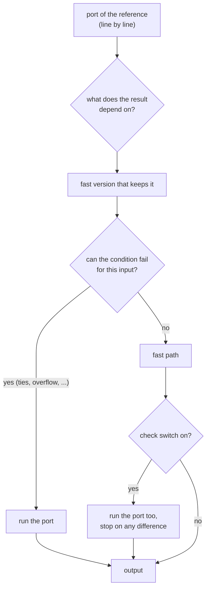
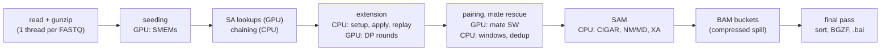
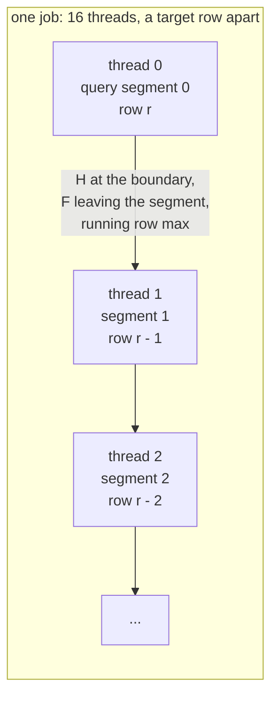
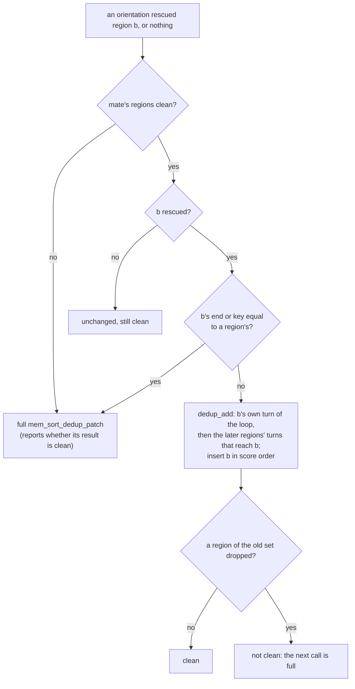
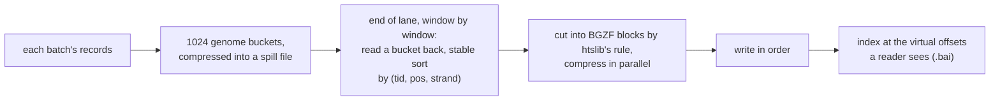
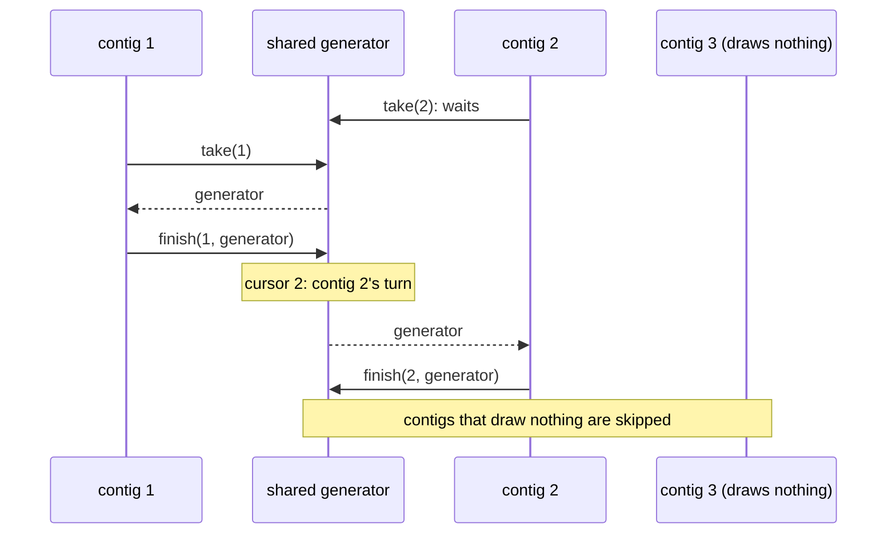

# Optimizations

Every optimization described on this page keeps the output identical to that of the reference tool: the records
of bwa-mem2, and the BAM files, tables and VCF files of Picard and GATK. The page explains what was done and why
each change is exact, so that later optimizations can build on the same arguments. Measurements, profiles and
approaches that were abandoned are recorded in [notes/](notes/), and the plan is in [notes/plan.md](notes/plan.md).

Unless an L40S is named (a server with 2 × EPYC 9654), the numbers were measured on one 16-core (32-thread)
workstation with an RTX 5070 Ti. The **`mid` set** is a 30x subset of NA12878 (~1/5 of a lane) that is used for
quick A/B runs, and a **lane** is one of the 12 FASTQ lane pairs of the genome (~64 M records).

* [Method](#method)
* [align-rs](#align-rs)
  * [Pipeline stages and throughput](#pipeline-stages-and-throughput)
  * [GPU kernels](#gpu-kernels)
  * [CPU optimizations](#cpu-optimizations)
  * [Memory and allocation](#memory-and-allocation)
  * [BAM output](#bam-output)
  * [Rejected optimizations](#rejected-optimizations)
  * [Candidate optimizations](#candidate-optimizations)
* [variant-rs](#variant-rs)
* [Proposing an optimization](#proposing-an-optimization)

## Method

Each component is first ported line by line from the reference. A faster version replaces part of a port only
after it has been shown to give the same result, which is done in three steps:

1. **Identify what the result depends on.** This is usually an order (the element at which a loop stops, or the
   way a sort breaks ties) or a rounding. Most of the work that the reference performs does not affect it.
2. **Compute the same result faster while preserving that dependence.** Typical means are to skip work that
   provably changes nothing, to replace a scan by an index, and to sum integers in any order.
3. **Check the result.** The ported version is kept beside the fast one behind a switch (`ALIGN_RS_*_CHECK=1`)
   that runs both and stops on the first difference, and whole outputs are compared on data that exercises the
   path.



The same patterns recur throughout the code:

| Pattern | Example | Where |
|---|---|---|
| Fast path, port as fallback for ties | region sorts | [Sorts](#region-sorts) |
| Index instead of scan, same answer | replay lookup, `pos2rid` table | [Replay](#skip-test-of-the-replay), [pos2rid](#block-table-for-pos2rid) |
| Incremental, exact by an invariant | mate rescue dedup | [Dedup](#incremental-deduplication-in-mate-rescue) |
| Exact by an order (monotone test) | chain filter by group | [Chain filter](#chain-filter-grouped-by-read-interval) |
| A proof that a cheaper computation gives the same | ungapped extension, CIGAR band | [Shortcuts](#shortcuts-adopted-from-bwa-mem3) |
| Same arithmetic, reorganized | SIMD CIGAR fill, GPU kernels | [SIMD](#vectorized-cigar-alignment), [GPU](#gpu-kernels) |
| Integer sums in any order | BaseRecalibrator tables | [variant-rs](#integer-counts-in-baserecalibrator) |
| Bit-exact floating point | GPU PairHMM | [PairHMM](#gpu-pairhmm) |
| One sequential stream shared in order | GATK's random numbers | [Shared generator](#random-number-order-across-parallel-contigs) |

Each optimization started from a measurement, for which the following means are available:

* `ALIGN_RS_PROFILE=1` and `VARIANT_RS_TRACE_STAGES=1` report per-stage times, thread CPU time and counters.
* `ALIGN_RS_TRACE=file` writes a per-batch timeline of the stages and GPU calls of align-rs.
* CPU hot spots are located with samply on a build with frame pointers and line tables:
  `RUSTFLAGS="-C target-cpu=native -C force-frame-pointers=yes" CARGO_PROFILE_RELEASE_DEBUG=line-tables-only`.
  Samples should be weighted by thread CPU time and not by sample count.

## align-rs

### Pipeline stages and throughput

align-rs processes a lane as a pipeline of stages, each of which works on a different batch of reads at the same
time. The stages share the CPU threads and one GPU:



In steady state, the slowest stage determines the throughput. On a lane that took 122 s, the stages were busy for
the following times: extension 104 s, mate rescue 104 s, SA + chaining 93 s, seeding 92 s, read 65 s, SAM 51 s
and write 39 s.

For a single lane, reducing the cost of one stage may therefore leave the elapsed time unchanged. The threads that
are freed go to the other stages, which then run ahead and wait, and because Rayon workers spin before they sleep,
the total CPU time may hardly decrease either. The chain filter described below reduced the user CPU time of a lane
by 5% and left its elapsed time unchanged.

For a whole genome, the same saving does reduce the elapsed time. The pipeline aligns the 12 lanes of a sample in
one process and overlaps the final pass of each lane with the alignment of the next, so all 32 threads stay busy
and a reduction in CPU time shortens the run. The mate rescue dedup reduced the alignment of the genome from 29.7
to 26.4 minutes. The chain filter, the B-tree search and the SIMD CIGAR fill, which hardly changed the time of one
lane, reduced it further from 26.4 to 23.6.

On the workstation, the GPU was busy for 60-70% of a lane (`nvidia-smi`; kernels ~83 of ~105 s, with seeding,
extension and mate SW at 25-27 s each) and idle during the final pass.

### GPU kernels

#### Seeding with a group of lanes per read

With one thread per read, only 3 of the 32 lanes of a warp were busy, because a few repetitive reads in each warp
run ~10× longer than the others. The kernel `k_smem_g<G>` gives each read G lanes instead. The forward walks run in
lockstep, and the candidates of the backward phase are extended G at a time. Every lane then replays the selection
of bwa in order on shuffled values, so that the seeds are exactly those of `one_pos`, including an `int32`
truncation. The groups are persistent and take reads from a counter, so that a slow read no longer holds 31 idle
lanes:

```cuda
for (;;) {
    int r = 0;
    if (lane == 0) r = atomicAdd(next_read, 1);
    r = __shfl_sync(mask, r, 0, G);
    if (r >= n_reads) return;
    ...
    while (x < len && !out.over) x = one_pos_g<G>(cp, q, len, x, 1, min_seed_len, out, prev, lane, mask);
```

This reduced the seeding kernel time from 1.22 to 0.68 s on 1M pairs (G = 4).

#### Seed extension with one memory word per DP cell

The banded Smith-Waterman extension (`ksw_extend2`) runs one job per thread. The DP row of each thread is held in
local memory, and Nsight Compute showed that the kernel was limited by L2 traffic. H, E and the query base are
therefore packed into one 32-bit word, so that a cell costs one load and one store (`align-rs/cuda/aln_ext.cu`,
`k_extend`):

```cuda
// H (bits 0-13), E (14-27) and the query base (28-30): one local load and one store per cell.
// H and E stay below h0 + qlen * max(mat); jobs where that could reach 2^14 go to the CPU.
#define EH(h, e) ((uint32_t)(h) | ((uint32_t)(e) << 14))
...
uint32_t x = eh[j];
int M = EH_H(x), e = EH_E(x), h, tt;
M = M ? M + mrow[EH_Q(x)] : 0;
...
eh[j] = EH(h1, e) | (x & EH_QM);   // H(i,j-1) for the next row, E(i+1,j)
```

Three further changes were made at the same time:

* the jobs are sorted by size on the device (CUB radix sort), so that the jobs of a warp take similar time;
* a job occupies 24 bytes, and the constants of a round are passed as kernel arguments;
* a grid-stride loop runs over a fixed number of blocks per SM, so that the rows stay in L1
  (`ALIGN_RS_EXT_BPSM`).

Together these reduced the kernel time from 6.9 to 4.7 s on 1/6 of a lane.

#### Mate rescue kernels

The mate SW kernel emulates the striped SSE `ksw_u8` of bwa with a half-warp per job. Because it waits on shuffles
and votes, its speed depends on the number of resident warps. The following changes increased its throughput from
164 to 306 GCUPS with every result field identical (`cuda/bench_msw.cu` checks the fields on a dumped chunk):

* the query length is a template parameter, so that the rows are held in registers instead of local memory;
* u8 saturation is omitted where H provably cannot reach 255;
* the registers are capped at 56 for 64-thread blocks.

The striped kernel still waited on its lazy-F loop and on a vote and a reduction per target row. The kernel
`k_matesw_wave` keeps 16 threads per job but gives thread t the query segment t (the columns that SSE lane t holds)
in registers, one target row behind thread t-1 (the register-tiled wavefront of CUDASW++4.0):



With this arrangement, no row needs a vote or a second pass. The striped semantics of bwa are preserved exactly:
the row maximum and E use the values before the lazy-F pass (F within the segment) and H uses the full F, so the
kernel carries two F chains. The argmax over a row is computed only when the row could exceed the maximum seen a
few rows earlier, a bound that the shuffles carry at no additional cost. Every result field was identical to that
of the striped kernel on a chunk of a lane and on 600,000 synthetic jobs. The time per 65,536 jobs decreased from
21 to 12 ms on an L40S and from 31 to 18 on the RTX 5070 Ti. `ALIGN_RS_MSW=striped` selects the earlier kernel.

#### Shortcuts adopted from bwa-mem3

bwa-mem3 identified two cases in which the DP of bwa provably gives the same result as a cheaper computation:

* **Ungapped extension.** Suppose the total loss along the seed's diagonal (a − score, summed over its cells) stays
  below the cost of the cheaper gap (open + extend). Then every gapped path scores at least 2 below the diagonal in
  its row and column, so the row maxima, new maxima and gscore that ksw_extend2 reports are those of the diagonal.
  The shortcut is taken only when three further conditions hold, as derived for this code: tlen >= qlen, every
  value on the diagonal is positive, and no z-drop occurs on the diagonal. The diagonal is walked on the GPU, in
  the key kernel that runs before the size sort. A quarter of the jobs take the shortcut and skip the DP
  (extension kernel −12% on the L40S). `ALIGN_RS_UNGAPPED=check` runs the DP as well and stops on a difference:
  there was none in the 229.8 M shortcut jobs of a 30x lane.
* **Certified CIGAR band.** When the read and reference segments have equal length, any path more than kc cells
  off the diagonal scores below the ungapped score su, where
  kc = (amax·len − o_ins − o_del − su) / (amax + e_ins + e_del). A band of min(w, kc) therefore gives ksw_global2
  the same score and the same direction bits along the backtrack, and kc = 0 skips the DP altogether. This halves
  the band cells of the CIGAR stage (22.4 G → 10.9 G on 5 M pairs) and takes its CPU time from 140 to 96 thread-s.
  `ALIGN_RS_CIGAR_BAND=check` runs both bands and stops on a difference.

### CPU optimizations

After seeding, extension and mate SW had been moved to the GPU, the 32 threads of the workstation became the
limiting resource. A samply profile of the `mid` set showed how the CPU time was distributed, and each component
described below was identified from it (762 thread-s at the first profile and 515 after the chain filter, with the
same records):

| Piece | First profile | After |
|---|---:|---:|
| mate rescue's region dedup | 17.6% | 4.3% (incremental dedup) |
| chain filter (`chain_flt`) | 9.3% | 5.2% (by group) |
| chaining's seeds and B-tree (`chain_seeds`) | 9.9% | 10.5% |
| extension's CPU side (setup, apply, replay) | ~14% | ~18% |
| CIGAR, NM/MD (`gen_cigar2`), of it the DP | 8.4%, 5.3% | 11.0%, 7.2%, then SIMD (below) |
| XA tags (`gen_alt`, with their CIGARs) | 6.1% | 8.1% |
| mimalloc, over all of these | 13.1% | 12.6% |

The shares in the last column refer to a smaller total, so the share of a component that did not change is larger.

#### Region sorts

bwa-mem2 sorts regions with `ks_introsort` of klib, which is not stable: regions with equal keys are left in an
order that only this algorithm produces. When no two *different* regions have equal keys, any sort gives the same
result. This condition holds for 99.6% of the sorts on real reads, so a fast sort runs first and the ported
introsort runs only for the remainder (`align-rs/src/ext.rs`):

```rust
pub fn a_idx_sort<K: Copy>(a: &mut [Reg], key: impl Fn(&Reg) -> K, lt: impl Fn(&K, &K) -> bool) {
    let mut ki: Vec<(K, u32)> = a.iter().enumerate().map(|(i, r)| (key(r), i as u32)).collect();
    let mut fast = ki.clone();
    fast.sort_unstable_by(|x, y| ord(&x.0, &y.0));
    // regions of equal keys must all be the same region
    let ok = fast.windows(2).all(|w| lt(&w[0].0, &w[1].0) || a[w[0].1 as usize] == a[w[1].1 as usize]);
    if ok { ki = fast; } else { crate::ksort::introsort(&mut ki, |x, y| lt(&x.0, &y.0)); }
    // ... permute `a` by ki
}
```

`a_idx_sort_packed` extends this to keys that fit in 96 bits (an end position; or score descending, rb, qb). The
key is placed above bit 32 of a u128 and the index of the region below it, a reused per-thread buffer is sorted as
integers, and the regions are permuted in place by cycles. `ALIGN_RS_SORT_CHECK=1` compares the result with that
of `a_idx_sort`, and the two were equal in the ~300 M sorts of a lane. The user CPU time on the `mid` set decreased
by 7%.

#### Skip test of the replay

After extension, bwa-mem2 replays the skip test of bwa: for every seed, it scans the kept regions in order and
stops at the first region that contains the seed. Only *whether* a region contains the seed affects the result, so
align-rs keeps the regions sorted by start and tests only those that could contain the seed, which lie in a
binary-search window `[seed end − longest region, seed start]`. `ALIGN_RS_REPLAY_CHECK=1` runs the scan of bwa
beside the lookup. On the second lane of real data, this check found a case that the first version had missed, in
which a seed is longer than every kept region and the window is empty.

```rust
let lo = kept.partition_point(|x| x.0 < s.rbeg + s.len as i64 - max_len);
let hi = kept.partition_point(|x| x.0 <= s.rbeg);
let contained = lo < hi && kept[lo..hi].iter().any(|&(_, pi)| test(&av[pi as usize]));
if replay_check() {
    // bwa's scan: the first `lim` regions not purged, in order
    /* ... */
    assert_eq!(contained, scan, "replay lookup differs from bwa's scan");
}
```

The replay decreased from 37.9 to 15.1 thread-s on 1/6 of a lane.

#### Incremental deduplication in mate rescue

In mate rescue, bwa-mem2 runs `mem_sort_dedup_patch` on the regions of the mate after each of the four
orientations. Each call performs two sorts and an overlap loop over every region, although at most one region has
been added. Because of reads with hundreds of regions, this accounted for 18% of the CPU time on the workstation.

The optimization relies on the following invariant. The regions of a mate are **clean** when their ends differ, the overlap
loop (by end) would drop none of them, and their final keys differ. The window of the loop for a region is the run
of regions immediately before it (by end) that are within reach. Adding a region b can only end such runs earlier,
so on a clean set only the tests that involve b can drop a region. `dedup_add` runs only those tests and inserts b
in score order:



`ALIGN_RS_DEDUP_CHECK=1` runs the full function on a copy at every call. The results were equal in all 84 M calls
of a 30x lane, of which 74% were incremental and 17% were skipped. Together with the packed sorts, this reduced the
time of the lane from 149.5 to 138.8 s and its CPU time by 21%, and the time of the whole genome on the
workstation from 40.1 to 36.9 min.

#### Chain filter grouped by read interval

`mem_chain_flt` of bwa-mem2 tests each chain, heaviest first, against every chain kept before it, until it finds
one that has a large overlap with it on the read and also outweighs it enough to drop it. On repetitive reads this
is quadratic: the `mid` set requires 13.4 billion pairs, 98% of them in the 8% of reads with 64 or more chains.
Because 91% of the pairs overlap (the overlap is measured on the read, 0-150 bases), a lookup by reference position
would not reduce their number.

The result depends on two properties:

* whether two chains overlap enough depends only on the kept chain's interval on the read (start, end, is_alt),
  and kept chains repeat their intervals: 98 M kept, 21 M distinct;
* the kept chains are in descending weight, and the drop test (weight below `drop_ratio` of the other's, and at
  least `2 × min_seed_len` below) holds for a heavier chain whenever it holds for a lighter one. So if any kept
  chain with a large overlap drops the new chain, the *first* one does, and bwa's loop stops there.

```text
sort chains by weight, descending                 # ks_introsort, as bwa
groups = []                                       # kept chains by read interval, in order of their first chain
for each chain i:
    g = first group whose interval overlaps i enough
    if g exists and g.first_chain drops i:        # the chain bwa's loop stops at
        set g.first_chain.first = i if unset
        continue                                  # i is dropped
    for each group h from g on that overlaps i enough:
        set .first = i on h's chains not yet set  # each chain is set once, then leaves h's list
    keep i, in its group (a new group if none)
```

The loop of bwa is retained for reads with fewer than 16 chains. `ALIGN_RS_CHAINFLT_CHECK=1` runs it beside the
grouped version on every call, and the results were equal on the `mid` set and on a whole lane. Seeding and
chaining decreased from 168-185 to 141-148 thread-s, and the user CPU time of a lane by 5%.

#### Branch-free node search in the chaining B-tree

Chaining keeps the chains in the B-tree of bwa (kbtree), ordered by position. The tree itself must be retained,
because the chain that it returns among chains at equal positions depends on its shape. The search inside a node
(at most 9 keys), however, is a binary search with unpredictable branches. Its result, the first key not below k,
equals the number of keys below k, because the keys of a node are sorted:

```rust
let mut begin = 0usize;
for i in 0..KB_N {
    begin += ((i < n) & (node.pos[i] < k)) as usize;
}
```

Seeding and chaining decreased from 141.6 to 136.1 thread-s on the `mid` set.

#### Block table for `pos2rid`

`bns_pos2rid`, which finds the reference sequence that holds a position, is a binary search over the 3,366 contigs
of hg38. It runs for every seed in chaining and again in SAM and mate rescue. It returns the last reference that
starts at or before the position, so its result is non-decreasing in the position: if the first and last positions
of a 64 kb block give the same reference, every position between them does as well. A table (47 k entries) answers
the query for such blocks, and only blocks in which a reference starts fall back to the search:

```rust
// built once: rid_tab[k] = the block's reference, or -1 if a reference starts inside it
let r = self.rid_tab[(pos >> 16) as usize];
if r >= 0 { return r; }
self.pos2rid_search(pos)
```

#### Vectorized CIGAR alignment

`gen_cigar2` aligns the read and reference segments of each region end to end (`ksw_global2`, a banded global DP
with a direction byte per cell for the traceback). Only one quantity is carried along a row of its loop, namely F, the
gap in the query direction, and the recurrence of F does not involve H:

```text
for target row i, query position k in the band:
    M = H(i-1, k-1) + score(target[i], query[k])     # from the row above: known for the whole row
    E = max(E(i-1, k) - e_del, M_above - o_del - e_del)
    F(k+1) = max(F(k) - e_ins, M(k) - o_ins - e_ins)   # depends only on M: a max-plus prefix scan
    H = max(M, E, F), direction bits from the same comparisons
```

Eight cells can therefore be computed at once with AVX2 (`kswg_fill_avx2` in `sam.rs`). F across 8 lanes is an
inclusive max-plus scan in three steps (shifts by 1, 2 and 4 lanes, subtracting 1, 2 and 4 × e_ins), followed by
the carry from the previous 8 cells decayed by (lane + 1) × e_ins. Integer maximum and subtraction are exact, so
every H, E, F and direction byte equals that of the scalar loop. The remaining details are as follows:

* H is stored one position further on, as in the in-place row of bwa;
* the stores at the end of the band are masked, so that nothing beyond the band changes;
* the shifts fill with a value far below any real score, so that a filler can never be selected by a maximum;
* the scalar loop is retained for CPUs without AVX2 and for very large gap penalties.

`ALIGN_RS_CIGAR_SIMD_CHECK=1` runs the scalar fill as well and compares the score and every direction byte. The
two were equal in the ~3.9 M DP calls of the `mid` set and on a whole lane, and a unit test compares 8,000 random
alignments. `ALIGN_RS_CIGAR_SIMD=0` disables the SIMD fill. The CIGAR/NM/MD step on a lane decreased from 584-589
to 405-439 thread-s (−28%), and the user CPU time of the lane by 3%.

### Memory and allocation

* **Allocator.** mimalloc is configured to purge freed memory with `MADV_FREE` instead of decommitting it, so that
  the next batch reuses the pages. Minor page faults decreased from 10.6 M to 2.0 M.
* **Fewer allocations per read.** Extension makes 4 allocations per read instead of 5 plus 3 per chain. The
  seed-to-region map of bwa is computed (`base_j + n_j − 1 − k`) instead of stored, and the seed orders of the
  chains form one vector with the same layout as the regions. With the `pos2rid` table, the time of a lane
  decreased from 135.3 to 122.4 s.
* **Allocation size.** Reducing the number of allocations further increased their size, with no benefit. When
  per-read vectors were merged into fewer, larger ones (the left and right templates of extension as pairs, the arrays of
  `chain_flt` as tuples), the allocation of a repetitive read fell into a larger mimalloc size class, whose pages
  were purged and faulted in again. Page faults increased ×3-5 and the run was no faster, so both were left as
  separate vectors.
* **Bounded freeing outside the stage threads.** The large structures of each batch are freed by dropper threads,
  so that the stages do not spend time on it. A single dropper fell behind once the batches became faster. Its
  queue held ~1 GB a batch, so the 12 lanes of the workstation filled 48 GB in ~6 minutes, and the alignment tasks
  on the server grew to 54-169 GB. Four threads now share a queue of at most 16 structures (~4 batches), and a
  stage waits when the queue is full. A task now uses 37 GB, and the germline run on the server decreased from 460
  to 409 s.

### BAM output

Instead of writing SAM for `samtools sort`, align-rs writes the sorted BAM and its index itself. The records and
the `.bai` are byte for byte those that samtools gives:



* **Buckets and spill** (`bam.rs`). A stable sort by (tid, pos, strand) gives the order of `samtools sort`.
* **Final pass in parallel** (`bam.rs`, `hts/alnhts.c`). With one thread passing records to the writer of htslib,
  the final pass took 25 s of a 30x lane. The records are now stored as `bam_write1` writes them, cut into blocks
  by the rule of `bgzf_flush_try`, compressed with `bgzf_compress` in parallel and indexed with `hts_idx_push`,
  and the sort, compression, write and index overlap window by window. On the L40S with 64 threads, the final pass
  decreased from 25 to 5 s and the lane from 108 to 88 s.
* **Stages and pools.** Five stages are connected by unbuffered channels. Pairing / SAM, rescue and the CPU steps
  of extension each have their own rayon pool, so that they do not queue behind the loops of the others. This
  reduced the time of a batch of one lane from 3.35 to 1.80 s, and the extension pool reduced a lane on the L40S
  from 113.6 to 108.5 s. Decompression uses one thread per FASTQ file, which reduced the read stage from 1.62 to
  1.05 s a batch.

### Rejected optimizations

Each of the following ideas was implemented or measured and then left out. The reason is recorded so that the
idea can be evaluated again if circumstances change.

| Idea | Result | Why not |
|---|---|---|
| Run only the extensions bwa's replay keeps | 73% of jobs kept | little to save |
| De-duplicate SA lookups | 35% repeats | the SA kernel is ~2 s a lane |
| Pinned staging buffers | slower under WSL2 | |
| Pinned extension buffers filled in place | copies 3-4× faster | wall unchanged: extension's GPU rounds already overlap its longer CPU work |
| More stage slack (batches in flight) | more memory | no gain |
| Mate SW as one thread per alignment | 1.25-1.3× on the kernel | ~5% of a lane, for a second kernel |
| Idle extension lanes take the next job (AGAThA) | lanes 53% busy | the kernel is paced by its working lanes' memory traffic: ~9% at best |
| bwa-mem3's certified adaptive extension band | a quarter of jobs certify | probe plus rerun take ×1.08 the kernel time |
| Parallel `start_side` in extension | stage 1.45 → 1.22 s a batch | the cores went to seeding and chaining; same wall |
| Larger merged per-read vectors | page faults ×3-5 | mimalloc size classes (above) |
| LZ4 for the BAM spill | ratio 0.234 vs zlib-rs level 1's 0.224, 1.3× / 1.8× faster to compress / inflate | ~1.2% of the CPU, for a dependency; uncompressed would need ~23 GB a lane on disk |
| Early exit from mate rescue's orientation scan | no change | the costly calls find no mate in range and scan all anyway |

### Candidate optimizations

* **Chaining on the GPU, for servers limited by the CPU.** Chaining takes ~16% of the CPU time (~500 thread-s a
  lane), and its seeds are already on the GPU. A kernel would use one thread per read and run the B-tree loop of
  bwa exactly, on very uneven work, since a few repetitive reads account for most of it. This would not help on
  the workstation, where the GPU is free for only ~35 s of a lane. The server, which runs 6 alignments on 384
  threads with its GPUs 23-32% busy, has far more capacity available.
* **The factors that limit extension and mate rescue.** The two longest stages each combine GPU and CPU work and
  share one GPU with seeding. Dividing the time of each batch into GPU work, waiting for the GPU and CPU work would
  show whether the next gain lies in overlapping the GPU calls or in their CPU parts.
* **GPU work for a configuration limited by the GPU.** The candidates are the mate-rescue pruning of bwa-mem3 (a
  third of the mate-SW cells on a dumped chunk) and a warp-uniform column loop in `k_extend` (its lanes read 3.44
  local-memory lines a step).

Each candidate is described in detail in [notes/align-rs.md](notes/align-rs.md).

## variant-rs

### Determinism under parallel execution

#### Integer counts in BaseRecalibrator

Without BAQ, BaseRecalibrator counts each error as 0 or 1, so each table cell is a pair of integers. Integer sums
do not depend on the order of summation, so tables computed per chunk can be summed in any order and still give
the sequential result of GATK. Only the floating-point finalization of GATK (`RecalDatum.combine`, rounding, the
Bayesian quality) runs once, in the order of GATK (`variant-rs/src/bqsr/recal.rs`):

```rust
/// Without BAQ (GATK's default) every error is 0 or 1, so a table cell is just (observations,
/// errors) integer counts: per-thread tables can be summed in any order and give GATK's values.
pub struct Counts {
    pub qual: Vec<[u64; 2]>,      // [rg][qual]
    pub context: Vec<[u64; 2]>,   // [rg][qual][context]
    pub cycle: Vec<[u64; 2]>,     // [rg][qual][cycle]
    ...
}
```

A whole genome takes 65 s, compared with 99 min for GATK.

#### Random number order across parallel contigs

GATK draws the random numbers for downsampling and for the QD jitter from one global `java.util.Random`, in
traversal order. To run contigs in parallel and still draw in that order, variant-rs passes the generator from
contig to contig in the order of GATK (`variant-rs/src/rng.rs`):



```rust
/// Blocks until contig `k`'s turn (every earlier contig of the domain is done with the generator).
pub fn take(&self, k: usize) -> T { /* wait on a Condvar until cursor == k */ }

/// Contig `k` is done with the generator.
pub fn finish(&self, k: usize, rng: T) {
    let mut s = self.m.lock().unwrap();
    assert!(s.cursor == k && s.rng.is_none(), "RNG baton out of order");
    s.rng = Some(rng);
    s.cursor = k + 1;
    Self::skip(&mut s);   // contigs that draw nothing are passed over
    ...
}
```

Two further measures keep the draws in order while avoiding waits:

* Genotyping writes a placeholder for each QD jitter and fills it in when the contig receives the generator.
* The downsampler, which needs the true state of the generator, waits only at its first drawing group.

As a result, contigs without drawing groups, which are the majority, never wait.

### Bit-exact floating point

#### GPU PairHMM

The PairHMM of GATK is the AVX-512 kernel of Intel GKL. Its rounding determines PL and QUAL values, so a GPU
kernel that is only approximately equal gives different VCF lines: an earlier CUDA version differed from GATK in
15 records of the first 3.8 M. `cuda_pairhmm.cu` is compiled with `-fmad=false -ftz=true`, and every operation
that GKL performs is written with an explicit rounding intrinsic. Fused multiply-adds appear only where GKL fuses,
and doubles are flushed to zero explicitly, because the MXCSR setting of GKL flushes doubles as well:

```cuda
// Flush-to-zero. GKL sets MXCSR.FTZ, which flushes denormal results of float AND double operations.
// nvcc -ftz=true covers float only, so every double result is flushed explicitly.
// |x| < DBL_MIN exactly when the exponent field is 0: tested on the integer bits, off the slow FP64 units.
__device__ __forceinline__ double FZ(double x) {
  const long long u = __double_as_longlong(x);
  return (u & 0x7ff0000000000000LL) == 0 ? __longlong_as_double(u & (long long)0x8000000000000000ULL) : x;
}
// Explicit fused multiply-add (the file is compiled with -fmad=false, so nothing else is contracted).
__device__ __forceinline__ float  FMA(float a, float b, float c) { return __fmaf_rn(a, b, c); }
__device__ __forceinline__ double MUL(double a, double b) { return FZ(__dmul_rn(a, b)); }
```

Pairs are batched across regions into one launch. In the first version, each warp computed one (read, haplotype)
pair (whole genome: 23/23 shards identical, with the GPU busy for ~220 s of a ~12 min run). The float pass is now
tiled, as in gpuPairHMM (Schmidt et al., arXiv 2411.11547): a few threads per pair each hold K read rows in
registers and sweep the haplotype one step behind their neighbour, and the pairs are binned by read length. The
operations per cell are the same, so the results are bit-identical, at 2.4-2.8× the speed (282 → 663 GCUPS on
the L40S).

The contig workers share a pool of engines (each a CUDA stream with its own buffers, 8 per GPU by default) instead
of one engine behind a lock, so that the copies of one worker overlap the kernels of another, and the engines are
distributed over every visible GPU. For a 30x genome on an L40S at 64 threads, the time decreased from 190 to
122 s, and on 2 GPUs from 115 to 98 s, where the longest calling interval (141 Mb of chr2) sets the lower limit.

#### Java semantics

A single incorrect tie-break or rounding changes a VCF line, so the behaviour of Java is reproduced in shared
helper functions, each with a unit test. For example, `f64::total_cmp` sorts the NaN that `0.0/0.0` produces on
x86-64 *first*, whereas `Double.compare` of Java places every NaN *last* (`crates/assembly/src/jmath.rs`):

```rust
/// `Double.compare`: every NaN is equal to itself and above +Infinity, -0.0 < 0.0.
pub fn java_cmp(a: f64, b: f64) -> std::cmp::Ordering {
    match (a.is_nan(), b.is_nan()) {
        (true, true) => std::cmp::Ordering::Equal,
        (true, false) => std::cmp::Ordering::Greater,
        (false, true) => std::cmp::Ordering::Less,
        _ => a.total_cmp(&b),
    }
}
```

Other helpers of the same kind reproduce the following:

* `Math.log10` / `exp` / `pow` as the JDK computes them;
* the rounding of `String.format`;
* the re-encoding of BAM tags by htsjdk, in which tags are sorted by binary key, integers are narrowed to the
  smallest type and H tags are written back as `B:c` (`bamwrite.rs`, `normalize_tags`);
* the iteration order of `HashSet` in Picard.

### Data movement

#### Pileup accumulation

GATK builds a pileup object for each locus. variant-rs instead traverses the CIGAR of each read once and adds its
bases directly to a ring buffer of per-locus accumulators (`frontend.rs`, `Ring`). The reads are added in file
order, so the floating-point sums are accumulated in the same order as in GATK and are bit-identical. One thread
adds reads to loci ahead of the frontier while another evaluates the loci behind it. When a read spans more loci
than the ring holds, the ring is enlarged first.

#### Streaming input and output

* **MarkDuplicates.** Pass 1 runs over 2 Mb chunks in parallel. Read ends are written to on-disk buckets keyed by
  (contig, position), and the buckets are grouped in parallel with the comparator of Picard. Pass 2 rewrites the
  records in parallel and appends them in order. The ends on disk are packed (35 bytes a fragment, 50 a pair) and
  are read directly into their arrays. A whole genome takes 3.1 min, compared with 42 min for Picard.
* **ApplyBQSR.** The quality bytes of each record are rewritten in place, and the tags are re-encoded as htsjdk
  does.
* **BGZF.** All compression and decompression runs in parallel with libdeflate, and the `.bai` / `.tbi` indexes
  are built while the file is written.

## Proposing an optimization

1. **Profile first**, with the switches and the samply configuration described
   [above](#method), and confirm that the component limits the throughput: on one lane,
   improving a stage that is not the slowest does not reduce the elapsed time (see
   [the pipeline](#pipeline-stages-and-throughput)).
2. **Count before writing code.** A few counters often show whether an idea can succeed. For the chain filter, the
   number of pairs showed that a lookup by position would remove almost none of them and that grouping would.
3. **State why the change is exact.** Give the invariant or order that it preserves, and the fallback that is
   taken when the invariant does not hold.
4. **Add a check mode** such as `ALIGN_RS_REPLAY_CHECK` that runs the plain version beside the fast one, and run it
   on data that exercises the path (a whole lane in addition to the small tests).
5. **Show that the outputs are unchanged** (see [CONTRIBUTING.md](../CONTRIBUTING.md)) and report timings before
   and after the change. The two builds should be run alternately, because the variation between runs on one
   machine is several percent.
